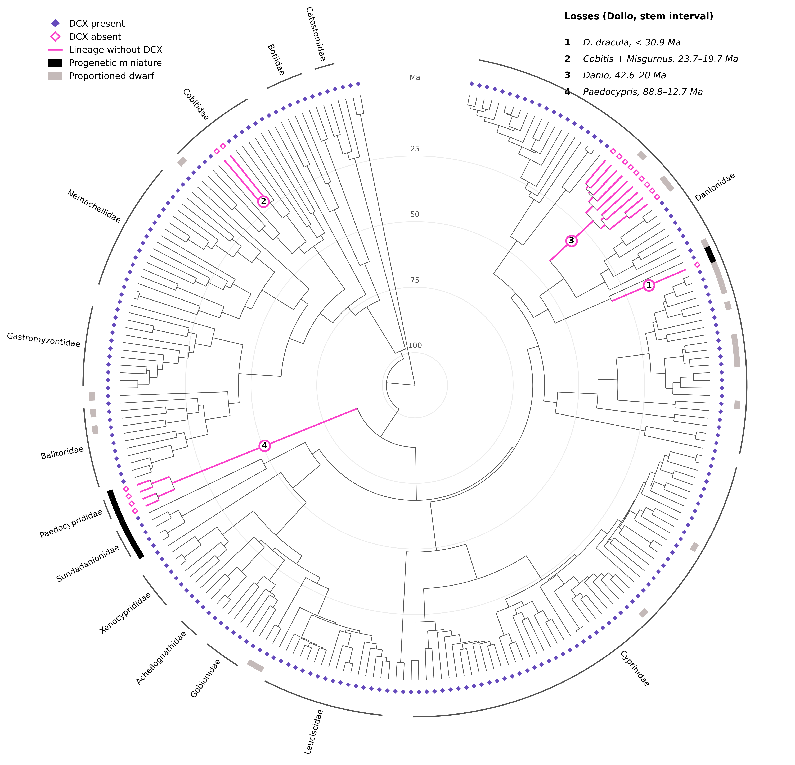

# Repeated loss of the neuronal gene doublecortin (DCX) in cypriniform fishes

Data and code for the article

> Alemán-Gutiérrez, A. Cypriniform fishes lost doublecortin repeatedly despite strong purifying selection on the gene. Submitted.

Doublecortin (DCX) is a microtubule-associated protein of migrating neurons, annotated in nearly all vertebrate genomes. This project shows that the gene was lost at least four times in cypriniform fishes, in *Danio* (including zebrafish), *Danionella dracula*, *Paedocypris* and cobitid loaches. *DCX* is strongly constrained in the species that keep it.

Each loss is supported by verified orthology, synteny and raw sequencing reads. A read-based census of 243 specimens from 225 species places the losses on a time-calibrated phylogeny. The losses followed different genomic routes, and every lineage without *DCX* retains *dclk1a*, a paralogue with the same microtubule-binding domains.

*Four losses of DCX (magenta) on the time-calibrated tree of 230 cypriniform fishes (Figure 6 of the article).*

## Contents

| Folder | What it holds |
|---|---|
| `scripts/` | The analysis, grouped by step (table below) |
| `results/census_runs/` | Read-based census, one `.res` file (DCX and control read counts) and one `.spots` file per SRA run |
| `results/census_runs_15M_repeated/` | First-pass results (15 M spots) of the four runs repeated with 40 M spots |
| `results/phylogenetics/` | Census table matched to tree tips, Dollo losses, pruned dated tree and robustness analyses |
| `results/expression/` | *C. idella* tissue expression and *P. micromegethes* Iso-Seq junction counts |
| `figures/` | Figures 1 to 6 and Supplementary Figures S1 to S4 (PNG and PDF) |
| `tables/` | Supplementary Tables S1 to S6 (xlsx and tsv) |

`results/phylogenetics/tabla_dcx_arbol.tsv` is the authoritative per-run census table (243 runs). All downstream analyses use it.

## Analysis steps

| Step | Folder | Analysis | Figure or table |
|---|---|---|---|
| 1 | `01_family_census` | Census of 16 DCX/DCLK genes in 24 genomes with reciprocal best hits | Fig. 1B |
| 2 | `02_species_tree` | Species tree from 49 nuclear genes and topology tests | Fig. 1A, Fig. S2 |
| 3 | `03_raw_read_tests` | Raw-read test of gene absence against single-copy paralogues | Fig. 2, Table S2 |
| 4 | `04_read_census` | DIAMOND-based census of 243 SRA runs (`server/` holds the parallel runner) | Table S3 |
| 5 | `05_synteny_compaction` | Microsynteny, genome compaction control and structure of the *Paedocypris* deletion | Fig. 3 |
| 6 | `06_selective_constraint` | dN/dS, FEL and RELAX against 46 random genes | Fig. 5, Fig. S3 |
| 7 | `07_dcl_isoform_expression` | DC-only isoform of *dclk1a*, Iso-Seq junctions and adult tissue RNA-seq | Fig. 4, Fig. S4, Table S6 |
| 8 | `08_phylogenetic_comparative` | Dollo parsimony, stochastic mapping, Pagel tests and robustness across trees | Fig. 6 |
| 9 | `09_vertebrate_survey` | *DCX* annotation across 884 vertebrate genomes | Fig. S1 |
| 10 | `10_figures_tables` | All figures and supplementary tables | |

## Reproducibility notes

All input data are public (NCBI Datasets, RefSeq and SRA/ENA), and their accessions are listed in `tables/`. Genome assemblies and reads are not redistributed, and the scripts download them. External trees are cited, not copied: the time-calibrated tree of Sudasinghe et al. (2026, Zenodo 10.5281/zenodo.23008328) and the Fish Tree of Life (Rabosky et al. 2018).

The scripts were written for the author's machines and a 96-core server, so paths (`${DATA}`, `${HOME}/...`) must be edited before rerunning. Comments and some column names are in Spanish.

## Software

- Sequence search: BLAST+ 2.12.0, DIAMOND 2.1.10, SRA Toolkit 2.11.3 and 3.1.1
- Alignment and phylogenetics: MAFFT 7.490, IQ-TREE 2.0.7
- Mapping: miniprot 0.13 and 0.18, minimap2 2.28
- Selection: HyPhy 2.5.103
- Comparative analyses: R 4.1.2 with ape 5.8.1 and phytools 2.5.2
- Python 3.11 with pandas, Biopython and matplotlib 3.8.4

Figures use a palette derived from León et al. (2024) and were checked under simulated colour-vision deficiencies.

## Licence

Code is released under the MIT licence. Results and tables are released under CC BY 4.0 (`LICENSE`).

## Contact

Alvaro Alemán-Gutiérrez
- Instituto Tecnológico de Costa Rica and Universidad del Bío-Bío
- user@itcr.ac.cr
- ORCID [0000-0001-9916-6980](https://orcid.org/0000-0001-9916-6980)
